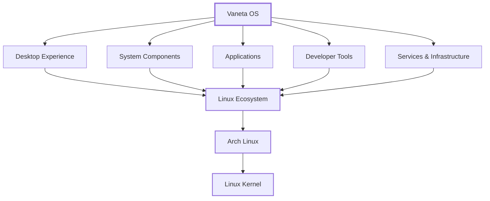

  <h1>Vaneta OS</h1>
  
<b>Reimagining the Desktop Experience</b>

  

    <a href="https://vanetaos.com">Website</a> •
    <a href="https://download.vanetaos.com">Download</a> •
    <a href="https://docs.vanetaos.com">Documentation</a> •
    <a href="https://support.vanetaos.com">Support</a> •
    <a href="https://forum.vanetaos.com">Forum</a> •
    <a href="https://community.vanetaos.com">Community</a>
  

   

### Get Vaneta OS

Ready to experience Vaneta OS?

   

  

   
   

Choose your edition and get started with Vaneta OS.

### About Vaneta OS

**Vaneta OS** is a modern desktop operating system built on the Linux ecosystem and powered by the Arch Linux foundation.

We are focused on creating a complete, refined, and intuitive desktop experience that brings together elegant design, powerful system capabilities, and the flexibility of Linux into one cohesive platform.

Vaneta OS is designed with a simple belief: an operating system should not force users to choose between **beautiful design, performance, and freedom**.

### Our Vision

We are building Vaneta OS as more than another Linux distribution.

Our vision is to create a **complete desktop ecosystem** where the operating system, applications, system utilities, and user experience are designed to work together seamlessly.

We focus on:

- **Elegant User Experience:** Creating a polished, consistent, and intuitive desktop interface.
- **Performance & Efficiency:** Delivering a responsive operating system without unnecessary overhead.
- **Power & Flexibility:** Preserving the capabilities and freedom of the Linux ecosystem.
- **System Integration:** Building cohesive system components that work together rather than feeling like disconnected tools.
- **Long-Term Experience:** Developing a platform that can evolve continuously while maintaining consistency and reliability.

### Technology & Ecosystem

Vaneta OS is built on top of established open-source technologies while developing its own software, components, and ecosystem around them.

The repositories under this organization include:

- Core system components and services.
- Desktop utilities and system tools.
- Applications developed for the Vaneta ecosystem.
- UI components, themes, and design resources.
- Build systems and package infrastructure.
- Developer tools and supporting technologies.
- Experimental projects and research for future Vaneta features.

Our goal is not to reinvent every layer of the operating system, but to carefully integrate proven technologies and build the parts that make the **Vaneta experience uniquely ours**.

### Built on Linux

Vaneta OS uses **Arch Linux** as its foundation, giving the platform access to a powerful and flexible Linux ecosystem.

On top of that foundation, Vaneta OS develops its own experience through carefully selected technologies, custom components, system integration, and user-facing software.

### The Vaneta Experience

Every part of Vaneta OS is built with the same objective: **make the desktop feel cohesive.**

From the moment the system starts to the applications users interact with every day, we aim to maintain a consistent experience across the platform.

We care about the details, including the interface, interactions, performance, system behavior, and the way everything comes together.

### A Commercial Product, Built with Open Technology

Vaneta OS is a **commercial desktop operating system**.

While it is built upon Linux and other open-source technologies, Vaneta OS includes proprietary software, design, components, services, and intellectual property developed as part of the Vaneta ecosystem.

Open-source technology provides the foundation.

**Vaneta builds the experience.**

### Explore Vaneta OS

The repositories within this organization represent the technology behind the Vaneta ecosystem.

Whether you're interested in desktop Linux, system engineering, application development, interface design, or the technologies powering Vaneta OS, there's always something being built.

_(Pin Vaneta OS core repositories and public projects below.)_

---

  <i>"Reimagining the desktop experience, one layer at a time."</i>
    
  
© 2026 Vaneta. All rights reserved.

